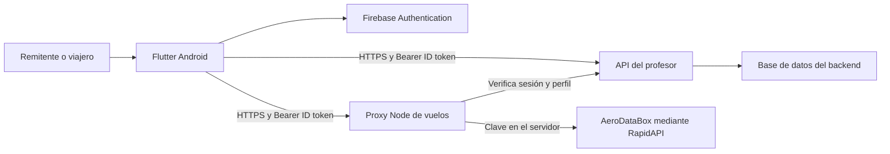

# Arquitectura de la versión 1.0.0

El cliente Flutter utiliza Firebase Authentication para identidad y el backend del profesor para perfiles, encomiendas, viajes y calificaciones. Un proxy Node incluido consulta AeroDataBox sin exponer la clave RapidAPI en la app.

La base de datos y el código del backend de negocio no se incluyen aquí. El adaptador de Firestore corresponde al chat preparado y desactivado; no se necesita para el alcance evaluado.

## Componentes

| Ubicación | Responsabilidad |
| --- | --- |
| `lib/auth/` | `AuthService`, Firebase y `AuthController`: acceso, perfil y sesión |
| `lib/roles/` | Rol del perfil y caché local separada por UID |
| `lib/data/` | Repositorios HTTP, catálogo de vuelos e historial recibido local |
| `lib/screens/` | Formularios, menús, listados y confirmaciones |
| `lib/widgets/` | Componentes, barra fija y protección de navegación |
| `lib/config/` | Visibilidad del alcance; chat y Google ocultos |
| `lib/chat/` | Contratos y adaptador para una etapa posterior |
| `flight_proxy/` | Servicio independiente de búsqueda de vuelos |
| `test/`, `integration_test/` | Contratos, estado, interfaz y recorrido con servicios simulados |

Las pantallas reciben servicios mediante scopes y la inyección de `LapticonApp`. `lib/main.dart` utiliza adaptadores reales; las entradas de integración usan servicios de prueba explícitos.

## Identidad y peticiones

Firebase restaura la sesión. Cada petición protegida obtiene un ID token y lo envía como `Authorization: Bearer <idToken>`. No existe un almacén propio de tokens ni persistencia de contraseñas. Los formularios fallidos conservan su contenido en memoria hasta salir de la pantalla.

`ApiClient` acepta HTTPS, no reenvía tokens por redirecciones y traduce errores de red, permisos y servidor. Ante 401 renueva y reintenta una vez; un segundo rechazo cierra la sesión. El 403 comunica falta de permisos sin cerrar automáticamente.

## Contratos principales

| Operación | Rutas |
| --- | --- |
| Perfil | `GET /api/users/{uid}`, `POST /api/users/register` |
| Rol | `PUT /api/users/{uid}` y GET para verificar persistencia |
| Lugares | `/api/ciudades/paises`, `/api/ciudades/ciudades-por-pais` |
| Crear y listar propias | `POST /api/encomiendas`, `GET /api/encomiendas` |
| Buscar y tomar | `GET /api/encomiendas/buscar`, `PUT /api/encomiendas/tomar/{id}` |
| Entrega | `PUT /api/encomiendas/{id}/estado`, con `estado: recibida` |
| Viajes | `GET /api/viajes`, `GET /api/viajes/disponible`, `POST /api/viajes`, `PATCH /api/viajes/{id}/estado` para cancelar |
| Calificaciones | `POST /api/ratings`, consulta pública `GET /api/ratings/{uid}` |
| Catálogo independiente | Proxy: `GET /api/flights/search?origin=...&destination=...&date=...` |

El proxy decodifica la identidad del token y la comprueba consultando el perfil protegido en la API, que valida Firebase. Solo después consulta al proveedor de vuelos. No utiliza claves Firebase Admin.

## Datos locales y navegación

SharedPreferences conserva el rol por UID y una copia de las entregas que esa cuenta marcó como recibidas desde el dispositivo. Los datos de negocio y las calificaciones pertenecen al backend. La caché no sustituye la autorización ni un historial remoto completo.

Al cambiar la identidad se descartan las pantallas de la sesión anterior. La navegación protege cambios sin enviar y operaciones en curso; los controladores evitan utilizar respuestas tardías en otra cuenta. Los HTTP 200 no se toman como prueba suficiente de persistencia cuando el contrato no confirma el campo; véanse las [limitaciones](LIMITACIONES.md).
